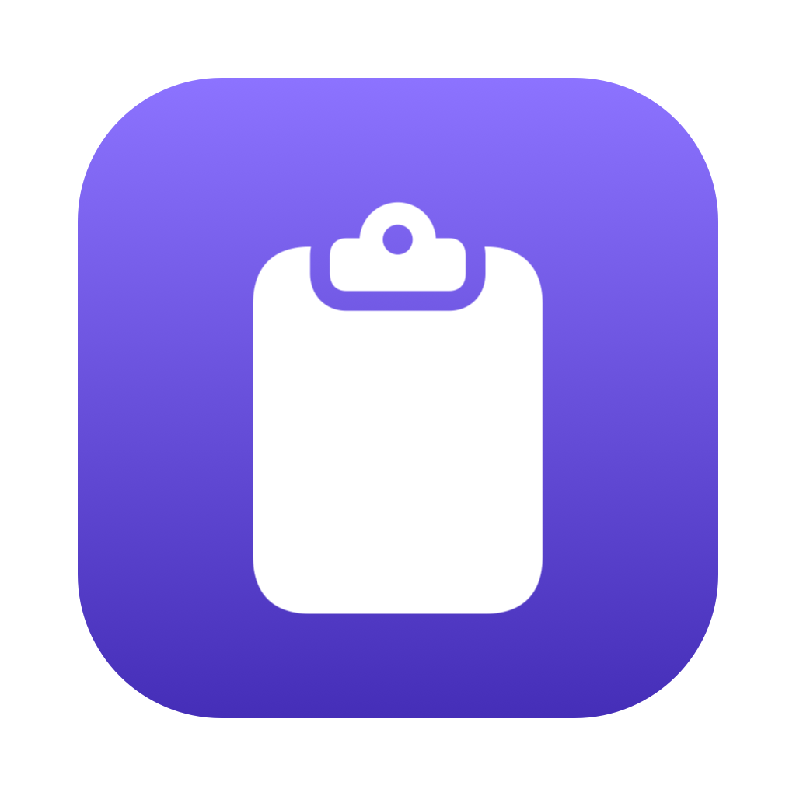
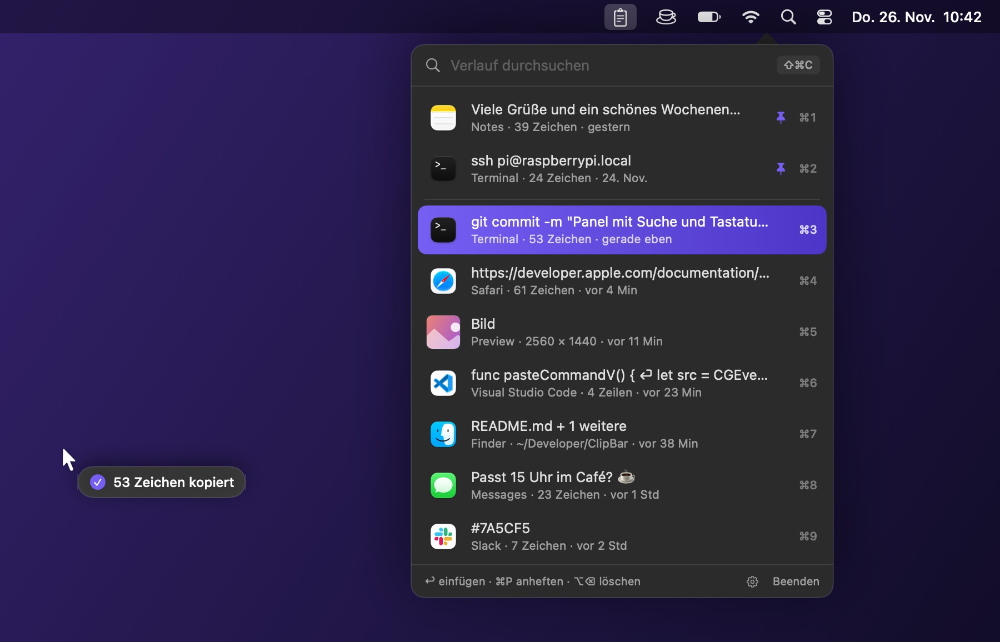

<p align="center"></p>

# ClipBar

Ein schlanker Verlauf der Zwischenablage für die macOS-Menüleiste. Er ist mein Ersatz für Maccy, nur ohne Ton und ohne Mitteilung beim Kopieren.



## So funktioniert's

- **Kopieren wie immer mit ⌘C.** Alles, was du kopierst, landet automatisch im Verlauf. Als Rückmeldung gibt es nur einen kleinen, lautlosen Hinweis am Mauszeiger, und das Symbol in der Menüleiste blinkt kurz.
- **Verlauf öffnen** mit **⇧⌘C** oder per Klick auf das Symbol in der Menüleiste.
- Einfach lostippen, um zu suchen. Mit **↑/↓** und **↩** wählst du einen Eintrag aus, er wird dann direkt in die vorherige App eingefügt. **⌘1–9** wählt einen Eintrag sofort.
- **⌥↩** kopiert nur, ohne einzufügen. **⌘P** heftet einen Eintrag an, **⌥⌫** löscht ihn. Ein Rechtsklick auf einen Eintrag zeigt dieselben Aktionen.
- Gespeichert werden Text, Bilder und Dateien, jeweils mit der App, aus der sie kopiert wurden.
- Passwörter aus Passwortmanagern werden nie gespeichert. Sie sind als „concealed“ bzw. „transient“ markiert und werden übersprungen.

## Einstellungen (⚙︎ im Panel)

| Option | Standard |
|---|---|
| Tastenkürzel zum Öffnen: ⇧⌘C, ⇧⌘V, ⌥⌘V oder ⌃⌘V | ⇧⌘C |
| Größe des Verlaufs: 50 bis 1000 Einträge, angeheftete zählen nicht mit | 200 |
| Beim Kopieren: Hinweis am Mauszeiger, nur Symbol in der Menüleiste oder nichts | Hinweis |
| Direkt einfügen, sonst wird nur kopiert | an |
| Bei Anmeldung starten | aus |

**Direkt einfügen** braucht die Freigabe unter *Systemeinstellungen → Datenschutz & Sicherheit → Bedienungshilfen*, weil ClipBar dafür ⌘V simuliert. Ohne diese Freigabe wird nur kopiert.

## Installieren

```bash
./build.sh
```

Das Skript baut die App, signiert sie und kopiert sie nach `~/Applications`. Liegt ein „Apple Development“-Zertifikat vor, wird damit signiert, sonst ad hoc. Mit dem Zertifikat bleibt die Freigabe unter Bedienungshilfen auch nach einem Neubau erhalten.

Der Verlauf liegt unter `~/Library/Application Support/ClipBar/`.

## Deinstallieren

```bash
pkill ClipBar; rm -rf ~/Applications/ClipBar.app ~/Library/Application\ Support/ClipBar
```
